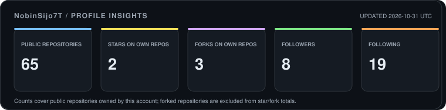
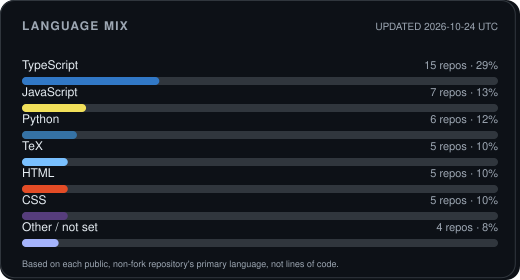
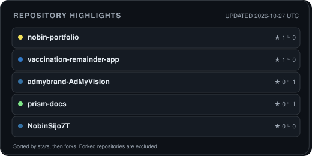
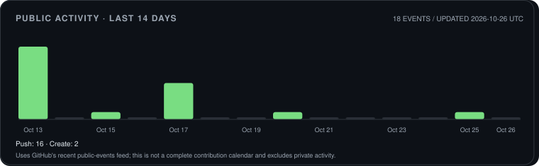

<h3 align="center">Crafting engaging experiences through the power of design and code</h3>

  
  
  
  
  
  
  

  

---

## Tech Stack

### Languages & Web

  
  
  
  
  
  
  
  
  
  
  
  
  

### Platforms & Tools

  
  
  
  
  
  
  
  
  
  

### Design & Creative

  
  
  
  
  
  
  

### AI & Data

  

### Observability

  
  

---

## GitHub Insights

These cards are generated by this repository's GitHub Actions workflow from GitHub's public API. They refresh daily, and you can trigger an update manually from the **Actions** tab.

  

<table>
  <tr>
    <td width="50%" valign="top">
      
    </td>
    <td width="50%" valign="top">
      
    </td>
  </tr>
</table>

  

Activity note: the chart reflects events returned by GitHub's public-events API. It does not include private activity and is not a full contribution calendar.

---

Built with GitHub's public API, Python, SVG, and GitHub Actions.

